<a href="https://ken-n7.github.io/portfolio/">
  
</a>

  <a href="https://ken-n7.github.io/portfolio/"><b>Portfolio</b></a>
  &nbsp;·&nbsp;
  <a href="https://www.linkedin.com/in/john-kenneth-ca%C3%B1ete-b48766406/"><b>LinkedIn</b></a>
  &nbsp;·&nbsp;
  <a href="mailto:canetejohnkenneth04@gmail.com"><b>Email</b></a>

 

<picture>
  <source media="(prefers-color-scheme: dark)" srcset="assets/label-builds-dark.svg" />
  
</picture>

  <a href="https://github.com/Ken-n7/lakbayin">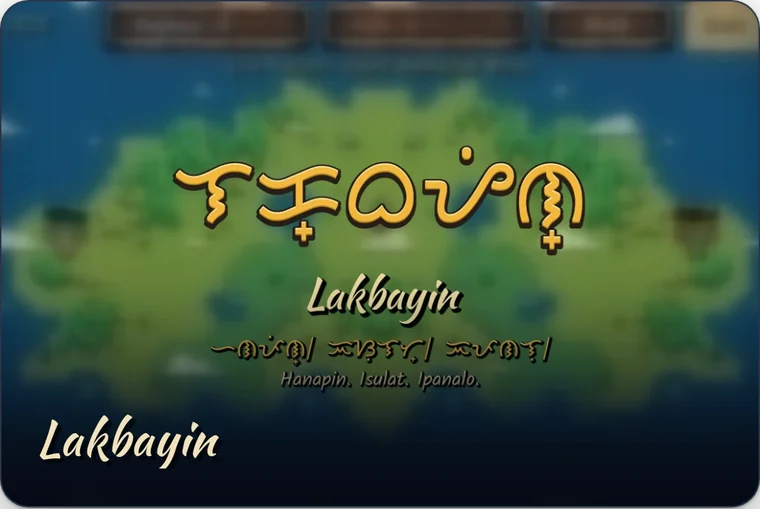</a>
  <a href="https://github.com/Ken-n7/escape-room-probability-game">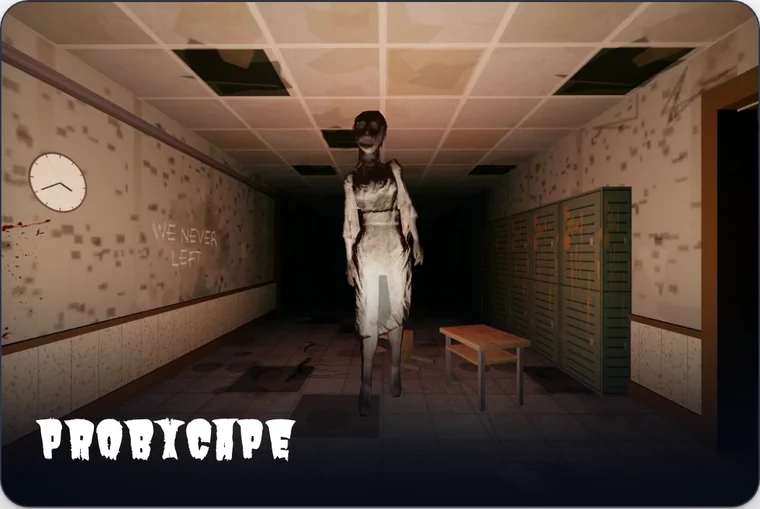</a>

  <a href="https://github.com/Ken-n7/integrid">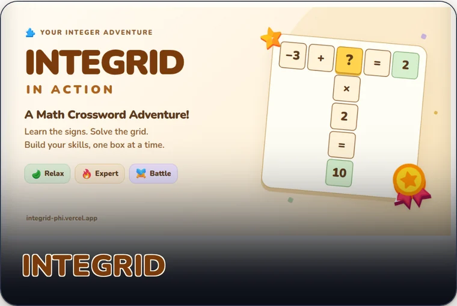</a>
  <a href="https://github.com/Ken-n7/swarm-gallery">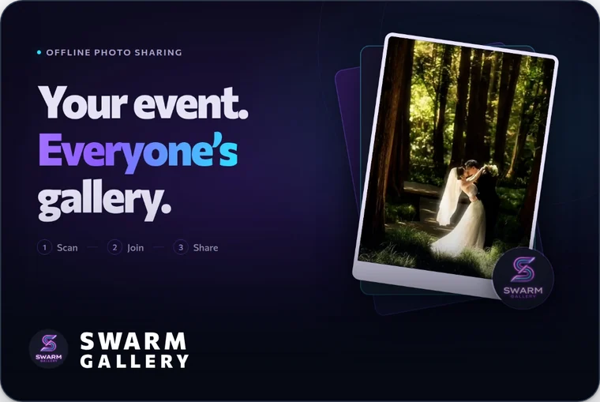</a>

  <a href="https://github.com/Ken-n7/reLiveTV">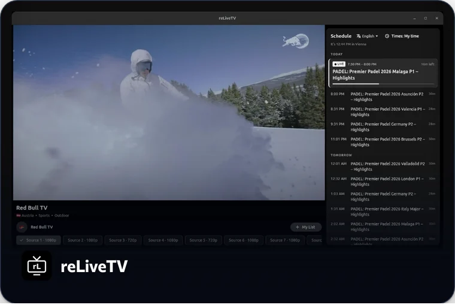</a>
  <a href="https://github.com/Ken-n7/consignment-ledger">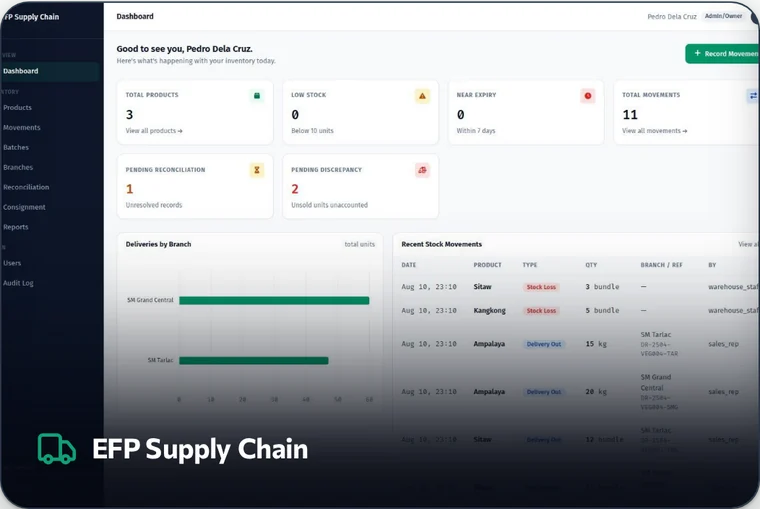</a>

  <a href="https://github.com/Ken-n7/sip_and_savor">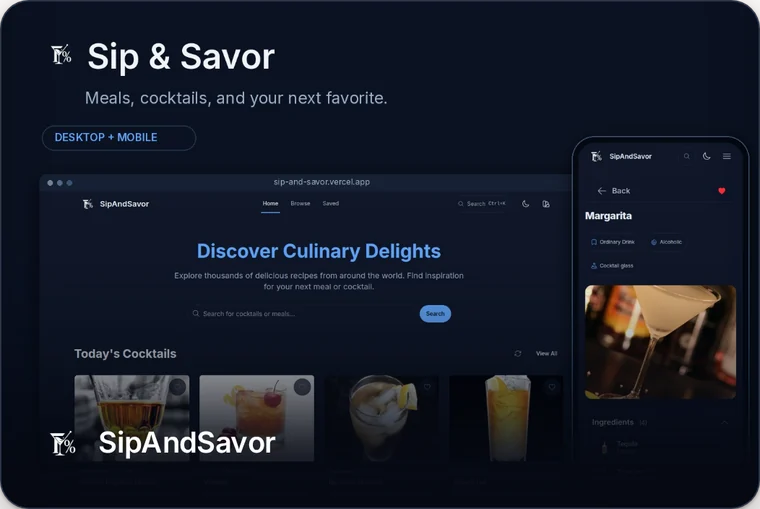</a>
  <a href="https://github.com/Ken-n7/tagtune">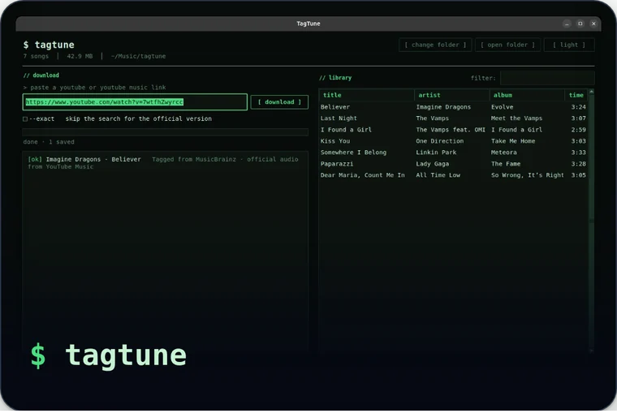</a>

  
    ▶ Play <a href="https://probxcape.vercel.app">ProbXcape</a>
    &nbsp;·&nbsp; ▶ Play <a href="https://integrid-phi.vercel.app">INTEGRID</a>
    &nbsp;·&nbsp; ▶ Try <a href="https://sip-and-savor.vercel.app">Sip &amp; Savor</a>
    &nbsp;·&nbsp; ⤓ Get <a href="https://github.com/Ken-n7/reLiveTV/releases/latest">reLiveTV</a>
    &nbsp;·&nbsp; trailers and demos on <a href="https://ken-n7.github.io/portfolio/">the portfolio</a>
  

 

<picture>
  <source media="(prefers-color-scheme: dark)" srcset="assets/label-stack-dark.svg" />
  
</picture>

  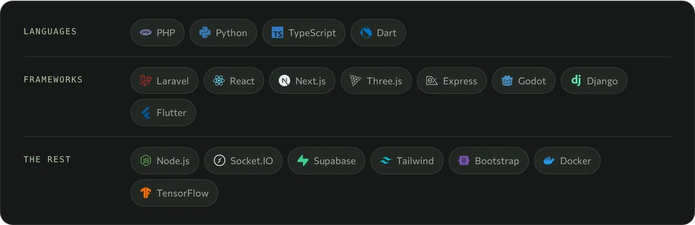

 

<picture>
  <source media="(prefers-color-scheme: dark)" srcset="assets/label-hi-dark.svg" />
  
</picture>

  <a href="mailto:canetejohnkenneth04@gmail.com">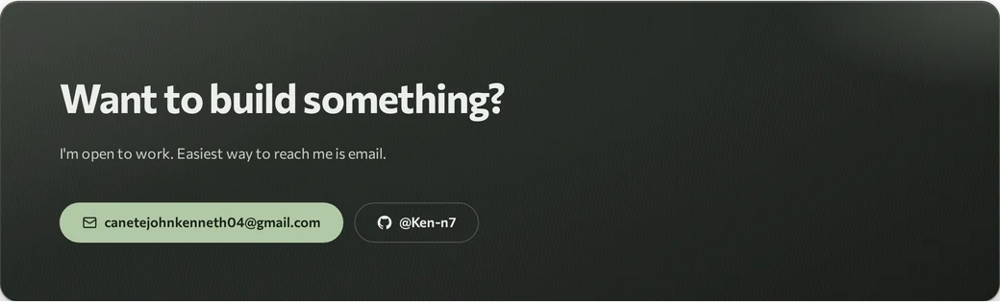</a>

<picture>
  <source media="(prefers-color-scheme: dark)" srcset="assets/footer-dark.svg" />
  
</picture>
