<picture>
  <source media="(prefers-color-scheme: dark)" srcset="assets/wave-dark.svg" />
  
</picture>

**[portfolio](https://ken-n7.github.io/portfolio/)** · **[linkedin](https://www.linkedin.com/in/john-kenneth-ca%C3%B1ete-b48766406/)** · **[canetejohnkenneth04@gmail.com](mailto:canetejohnkenneth04@gmail.com)**

<picture>
  <source media="(prefers-color-scheme: dark)" srcset="assets/footer-dark.svg" />
  
</picture>
